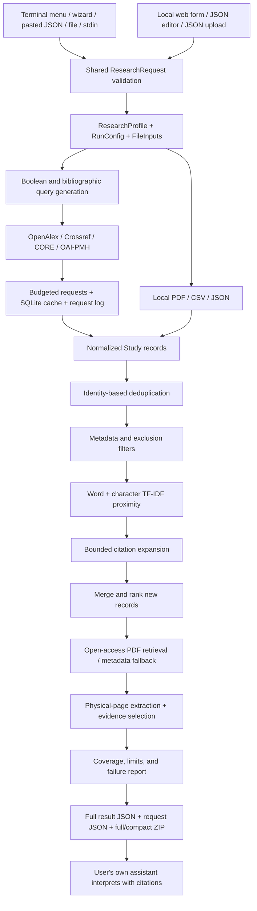
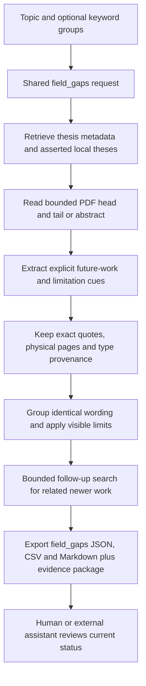

# Processing contract

## Modules

| Module | Responsibility |
|---|---|
| `models.py` | Shared request, profile, config, study, evidence, run schemas |
| `specification.py` | Template, JSON schema, assistant input prompt, parser |
| `cli.py` | Rich terminal UI, guided/pasted input, JSON stdout, web launcher |
| `query.py` | Concept grouping, source query dialects, normalization |
| `net.py` | Request budgets, retries, redacted diagnostics, SQLite cache/history |
| `sources.py` | Provider adapters, OAI continuation, CSV/JSON import |
| `documents.py` | PDF extraction and physical page identity |
| `scoring.py` | Deduplication, lexical ranking, evidence selection |
| `pipeline.py` | Shared retrieval/evidence orchestration |
| `export.py` | English reports/prompts, CSV/JSON/BibTeX/ZIP |
| `app.py` | Local near-black English web workspace |

## Invariants

- Neither interface calls a language model.
- Both interfaces validate the same strict request schema.
- JSON is parsed, not executed. Credentials are external to specifications.
- `run` stdout is a JSON document; presentation/progress belongs to stderr.
- CLI request-relative paths are resolved before saving a replay request.
- Portable ZIP requests exclude local paths and source PDF files.
- OAI-PMH is bounded repository harvesting, not subject search.
- Per-query, per-source, request, download, and page limits remain explicit.
- Citation expansion explores bounded, previously unexpanded seeds.
- Failed full-text access retains metadata and records an access note.
- Unknown year/type/language metadata remains visible rather than silently excluded.
- A phrase match is not a scientific finding or a validated novelty score.

## Thesis field-gap mode

`gaps.py` implements extraction and follow-up checks. Every candidate is author-reported and currently unverified. No match, failed access, or absent candidate proves that a problem is open or a field is complete.

## Topic branching

Topic input → bounded OpenAlex publication search → aggregate primary-topic IDs → fetch domain/field/subfield/topic paths and siblings → show alternative placements → shared tree → web SVG, terminal Rich tree, JSON/Markdown/SVG/text exports. A direct taxonomy search is the labeled fallback when publications provide no usable topic. `branches.py` owns retrieval, provenance and both renderers. Query attachment is inferred; source hierarchy edges are documented taxonomy relationships.

## Assistant handoff

All analysis modes → shared evidence selection → self-contained UTF-8 assistant brief (prompt + profile + coverage + findings + evidence + source catalogue) → selected local folder or browser download/copy. Terminal supporting JSON/ZIP files are grouped under `technical/<run-id>/`; archives also include `SEND_TO_ASSISTANT.md`. Local save uses exclusive creation so existing briefs remain intact.
